<picture><source media="(prefers-color-scheme: dark)" srcset="assets/hero-dark.svg"></picture>

<picture><source media="(prefers-color-scheme: dark)" srcset="assets/about-dark.svg"></picture>

<picture><source media="(prefers-color-scheme: dark)" srcset="assets/stack-dark.svg"></picture>

<a href="https://github.com/ChangedRuby/UniGym"><picture><source media="(prefers-color-scheme: dark)" srcset="assets/project-unigym-dark.svg"></picture></a>&nbsp;<a href="https://github.com/ChangedRuby/Html-Calculator"><picture><source media="(prefers-color-scheme: dark)" srcset="assets/project-html-calculator-dark.svg"></picture></a>

<a href="https://github.com/ChangedRuby/Java_Minesweeper"><picture><source media="(prefers-color-scheme: dark)" srcset="assets/project-java-minesweeper-dark.svg"></picture></a>&nbsp;<a href="https://github.com/ChangedRuby/WebSocket-Controller"><picture><source media="(prefers-color-scheme: dark)" srcset="assets/project-websocket-controller-dark.svg"></picture></a>

<a href="https://github.com/ChangedRuby/OOP-Exercises"><picture><source media="(prefers-color-scheme: dark)" srcset="assets/project-oop-exercises-dark.svg"></picture></a>

<picture><source media="(prefers-color-scheme: dark)" srcset="assets/stats-dark.svg"></picture>

<picture><source media="(prefers-color-scheme: dark)" srcset="assets/wave-dark.svg"></picture>

<a href="https://changedruby.com"><picture><source media="(prefers-color-scheme: dark)" srcset="assets/button-1-dark.svg"></picture></a>&nbsp;&nbsp;<a href="https://github.com/ChangedRuby?tab=repositories"><picture><source media="(prefers-color-scheme: dark)" srcset="assets/button-2-dark.svg"></picture></a>

<a href="https://metawka.github.io/expressive-profile/?from=ChangedRuby"><picture><source media="(prefers-color-scheme: dark)" srcset="assets/credit-dark.svg"></picture></a>

