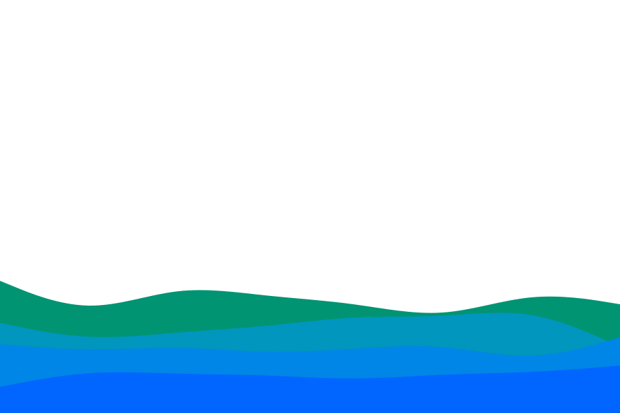
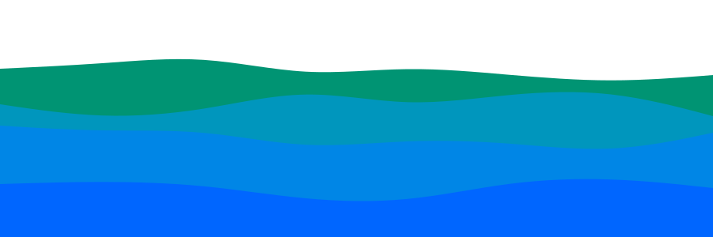

<!--
## Hello, I am Gustavo 👋
**ChangedRuby/ChangedRuby** is a ✨ _special_ ✨ repository because its `README.md` (this file) appears on your GitHub profile.

Here are some ideas to get you started:

- 🔭 I’m currently working on ...
- 🌱 I’m currently learning ...
- 👯 I’m looking to collaborate on ...
- 🤔 I’m looking for help with ...
- 💬 Ask me about ...
- 📫 How to reach me: ...
- 😄 Pronouns: ...
- ⚡ Fun fact: ...
-->

<h3 align="center" style="text-decoration: none;">🌎 My Website: <a href="https://changedruby.com">changedruby.com</a></h3>
<h3 align="center">🎥 Youtube: <a href="https://www.youtube.com/@gustavomacedo05">youtube.com/@gustavomacedo05</a></h3>

