<picture><source media="(prefers-color-scheme: dark)" srcset="assets/hero-dark.svg"></picture>

<picture><source media="(prefers-color-scheme: dark)" srcset="assets/about-dark.svg"></picture>

<picture><source media="(prefers-color-scheme: dark)" srcset="assets/stack-dark.svg"></picture>

<a href="https://github.com/ChangedRuby/Java_Minesweeper"><picture><source media="(prefers-color-scheme: dark)" srcset="assets/project-java-minesweeper-dark.svg"></picture></a>&nbsp;<a href="https://github.com/ChangedRuby/parallel-sorting-algorithms"><picture><source media="(prefers-color-scheme: dark)" srcset="assets/project-parallel-sorting-algorithms-dark.svg"></picture></a>

<a href="https://github.com/ChangedRuby/Artificial-Neural-Networks"><picture><source media="(prefers-color-scheme: dark)" srcset="assets/project-artificial-neural-networks-dark.svg"></picture></a>&nbsp;<a href="https://github.com/ChangedRuby/ML-Study"><picture><source media="(prefers-color-scheme: dark)" srcset="assets/project-ml-study-dark.svg"></picture></a>

<picture><source media="(prefers-color-scheme: dark)" srcset="assets/stats-dark.svg"></picture>

<picture><source media="(prefers-color-scheme: dark)" srcset="assets/wave-dark.svg"></picture>

<a href="https://changedruby.com"><picture><source media="(prefers-color-scheme: dark)" srcset="assets/button-1-dark.svg"></picture></a>&nbsp;&nbsp;<a href="https://github.com/ChangedRuby?tab=repositories"><picture><source media="(prefers-color-scheme: dark)" srcset="assets/button-2-dark.svg"></picture></a>

<a href="https://metawka.github.io/expressive-profile/?from=ChangedRuby"><picture><source media="(prefers-color-scheme: dark)" srcset="assets/credit-dark.svg"></picture></a>

